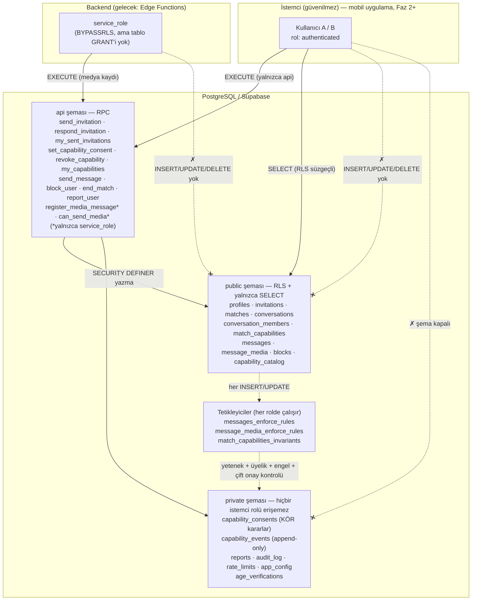
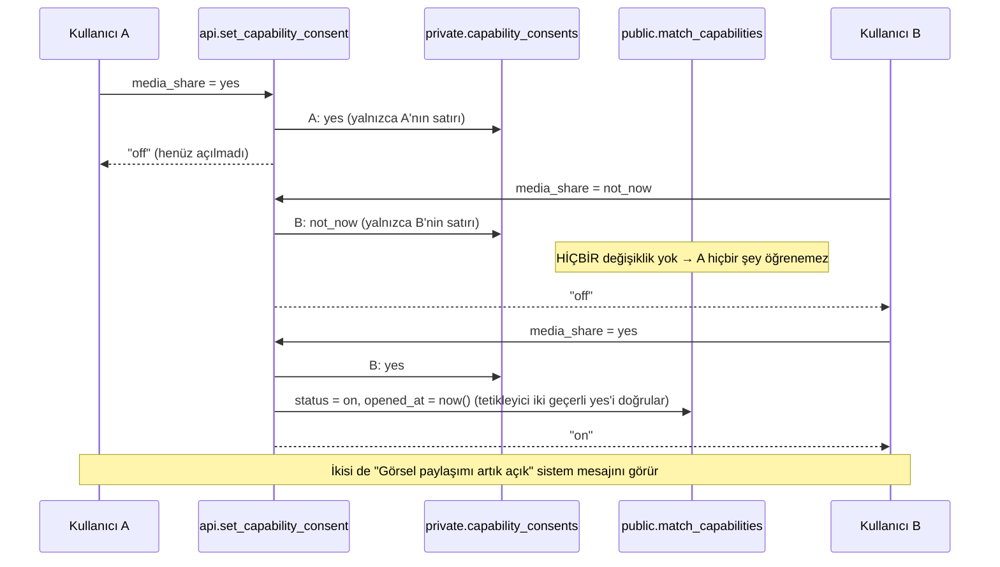

# Güven Çekirdeği — Mimari Diyagram (Faz 1)

## Katmanlar ve güven sınırları



## Kör onay akışı (media_share örneği)



## ASCII özet

```
 Mobil (authenticated) ──EXECUTE──▶ api.*  ──SECURITY DEFINER──▶ public.* tabloları ──▶ TETİKLEYİCİLER
        │                              │                                   ▲                (her rolde)
        └──SELECT (RLS)────────────────┼───────────────────────────────────┘                    │
 Backend (service_role) ──EXECUTE──▶ api.register_media_message ─────────────────────────────────┤
        ✗ tablo yazma yetkisi yok                                                                 ▼
                                                     private.* (kararlar, olaylar, raporlar) ◀── kontrol
```
